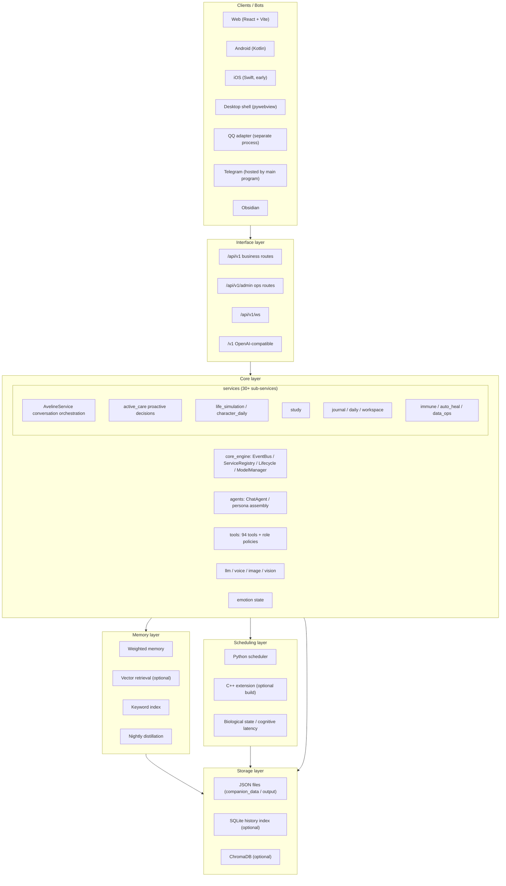

<div align="center">
  <picture>
    <source media="(prefers-color-scheme: dark)" srcset="autarkia-dark.svg">
    
  </picture>
  <p><strong>Self-hosted agent runtime: tool calling, long-term memory, proactive tasks, and multi-role isolation</strong></p>
  <p>
    <a href="https://github.com/hakituo/Autarkia/actions/workflows/core-ci.yml"></a>
    <a href="https://github.com/hakituo/Autarkia/actions/workflows/test-health.yml"></a>
    <a href="https://github.com/hakituo/Autarkia/actions/workflows/cpp-ci.yml"></a>
    <a href="https://github.com/hakituo/Autarkia/actions/workflows/web-ci.yml"></a>
    <a href="https://github.com/hakituo/Autarkia/actions/workflows/android-ci.yml"></a>
    <a href="LICENSE"></a>
    <a href="https://www.python.org/downloads/"></a>
  </p>
  <p>English | <a href="readme.md">简体中文</a></p>
</div>

## Overview

Autarkia is a self-hosted personal agent backend that runs on a single machine: a single-process Python (FastAPI) service with an optional C++ scheduling extension. Local GGUF / Transformers and cloud APIs both work as inference backends.

Conversation is its input/output interface, not its boundary. A single request may include multi-turn tool calls, state writes, memory updates, and follow-up tasks; personas constrain expression style and content boundaries, while actual capabilities are provided by the tool, memory, and service layers.

### Design principles

- **Persistent state**: memory, emotion, physiological, and daily-routine state survives across sessions and feeds context assembly and proactive-message decisions.
- **Tools first**: 94 tools across 26 domains, configured per role as resident / on-demand / disabled; write operations carry risk annotations and permission checks.
- **Proactive but controlled**: proactive messages are bounded by quiet hours, minimum intervals, daily caps, and a per-role allowlist, and can be paused or retuned at any time.
- **Role isolation**: memory, history, to-dos, and tool sets are scoped per role; data lives in `companion_data/<scope>_data/`.
- **Degrades gracefully**: C++ scheduling, ChromaDB, and the SQLite index are all optional; missing pieces fall back to Python or file paths.

| Positioning | Notes |
| --- | --- |
| Single-machine self-hosted | Personal deployment, no multi-tenancy |
| Agent runtime | Conversation + tool loop + task scheduling + state storage |
| Multi-role | Personas, memory, and tool permissions isolated per role |
| Not a pure chat product | Files, schedules, device control, and other external operations |

***

## Quick start

### Requirements

| Component | Requirement |
| --- | --- |
| Python | 3.10+ (3.13 recommended for the Linux target) |
| Node.js | 18+ (web frontend) |
| CUDA | 11.8+ (optional, local GPU inference) |
| RAM | 16GB+ (32GB recommended) |
| GPU VRAM | 8GB+ (for local inference; pure cloud API mode does not need it) |
| SoX / FFmpeg | Only required for voice features; provide the executables separately |

### Install dependencies

```powershell
# Windows CPU environment; run the two commands separately
.\venv_cpu\Scripts\python.exe -m pip install -r requirements\base.txt
.\venv_cpu\Scripts\python.exe -m pip install -r requirements\cpu.txt

# Verify dependency completeness
.\venv_cpu\Scripts\python.exe tests\scripts\environment\verify_runtime_dependencies.py --environment cpu
```

For a GPU environment, swap `venv_cpu` / `cpu.txt` for `venv_core` / `gpu.txt`. Full details in
[`requirements/README.md`](requirements/README.md).

### Configuration

```powershell
Copy-Item .env.example .env
```

Priority is "environment variables > YAML > code defaults". Sensitive values (API keys, tokens) go only into `.env`;
system switches live in `config/yaml/app.yaml`, model parameters and scene routing in `config/yaml/sections/`.

### Run

```powershell
# Backend only
python main.py

# Or start TTS, image generation, backend, and the frontend dev server in one go (the script uses venv_core)
start_scripts\start_services.bat
```

The web frontend runs separately on port 3000 by default and reaches the API through the Vite proxy on port 8000:

```powershell
cd clients\frontend\aveline-web
npm install
npm run dev
```

- Web: <http://localhost:3000>
- API docs: <http://localhost:8000/docs>
- Single-port mode: set `server.serve_frontend` to `true` (the PyInstaller build enables it automatically);
  port 8000 then serves `clients/frontend/aveline-web/dist` directly.

***

## How a message flows

1. `routers/v1/chat.py` (HTTP) and `/api/v1/ws` (WebSocket) receive the request and hand it to `AvelineService` in `core/services/aveline/service.py`.
2. `ChatAgent` in `core/agents/chat_agent.py` assembles the context: static system persona + dynamic user prefix (time, state, memory recall) + history; assembly logic lives in `chat_agent_components/persona_system/prompt/assembler.py`.
3. `core/llm/factory.py` picks a backend per configuration: local GGUF (llama-cpp), Transformers, cloud routing, or hybrid mode.
4. When the model decides to call a tool, `core/tools/execution.py` checks permissions against the role policy, executes, and returns the result to the model for the next round.
5. Streaming output passes through `chat_agent_components/streaming_pipeline/`; on completion it writes chat history, updates memory, and triggers post-processing (correction detection, learning consolidation, proactive-interaction decisions, etc.).

This is still a request-response conversational system — the response process may just contain multiple rounds of tool calls and state writes
instead of forwarding the user's words to a model and back.

***

## What it can do

### Conversation and tools

- Tools are registered once in `core/tools/registry.py`; roles get their tool sets through `config/tool_profiles.json`:
  `resident` sent every turn, `on_demand` discovered as needed, `disabled` hard-blocked.
- Currently **94 tools across 26 domains**: files, retrieval, schedules, to-dos, reminders, study, health, media, companion communication,
  device observation and control, remote operations, and more.
- Tools carry risk annotations: `external_write` (sending messages, setting reminders), `device_control` (starting/stopping apps, wallpaper, Bluetooth),
  `write` (writing local data, sandboxed code execution). Permission checks and execution context are unified in `execution.py`.
- Streaming conversation, tool-result backfill, multi-turn tool loops, and both native schema / local text protocol invocation styles.

### Memory

- Weighted memory, keyword index, vector retrieval, relation graph, forgetting probability, and nightly distillation; code in `memory/`.
- Vector retrieval uses a local embedding model by default; when the model or ChromaDB is missing it degrades to keyword and weighted paths,
  leaving basic memory reads/writes unaffected.
- Memory is isolated per role under `companion_data/<scope>_data/`; user-side profiles live in `companion_data/user_data/`.
- The recall entry point is `build_recall_bundle()` in `memory/search_mixin.py`, exposed as the
  `search_memory` / `search_chat_history` tools.

### Proactivity and life state

- `core/services/active_care/` is a resident decision loop: scheduled checks → gating and throttling → decision → post-send verification.
  Triggers include due reminders, long silences, and schedule nodes.
- Do-not-disturb is a hard constraint: quiet hours, minimum interval, daily cap, a required active client, and a per-role allowlist;
  the user can also pause or retune it directly (`pause_active_care` / `adjust_active_care_frequency`).
- `core/services/life_simulation/` maintains hunger, energy, sleep, and similar state; `core/services/character_daily/` generates each role's own
  daily routine. These states feed conversation context and proactive-message decisions rather than existing only for display.

### Study

- `core/services/study/` covers learner profiles, weak-area tracking, lesson orchestration, and daily plans.
- Vocabulary review uses FSRS scheduling (`core/tools/study/english/`); the daily word list merges "yesterday's missed words" with "words due in FSRS".
- Focus sessions, mistake records, and mastery tracking, with a matching study panel in the frontend.

### Multimodal

- Voice: TTS provider is configurable; STT supports local backends such as faster-whisper / paraformer.
- Vision: multimodal LLM first, falling back to a local vision module; supports screen and phone screenshot understanding.
- Image generation: local ComfyUI / Forge, or cloud SiliconFlow, switchable per configuration.

### Operations and self-improvement

- `core/services/immune/` monitors memory, CPU, error bursts, and service health, degrading or restarting services past thresholds.
- `core/services/auto_heal/` identifies anomalies from run logs (error bursts, repeated exceptions, business metric anomalies), performs root-cause analysis,
  and generates patches; patches pass a sandbox and approval first; only low-risk changes are applied automatically.
- `core/services/data_ops/` handles daily/weekly digests, memory compaction, and information extraction.
- `core/services/self_improvement/` collects user corrections, consolidates them into learning records, and promotes them into long-term rules or `MEMORY.md`, with drift protection.

### Clients

- Web: React + Vite, dev port 3000.
- Android: Kotlin + Jetpack Compose, with accessibility/Shizuku device control and Health Connect wearable data.
- iOS: Swift, currently an early implementation with less coverage than Android.
- Desktop: `desktop_app.py` wraps a pywebview window, with a transparent, always-on-top pet mode.
- Bots: the QQ adapter runs as a separate process (NapCat transport); Telegram is hosted directly by the main program.
- Also provides an OpenAI-compatible endpoint and an Obsidian endpoint.

***

## Architecture



| Layer | Directory | Responsibility |
| --- | --- | --- |
| Client layer | `clients/` | Web, Android, iOS, desktop shell, QQ/Telegram adapters |
| Interface layer | `routers/` | `/api/v1` business, `/api/v1/admin` ops, WebSocket, OpenAI / Obsidian compatibility |
| Core layer | `core/` | Service registry, conversation orchestration, agents, tools, model adapters, emotion |
| Memory layer | `memory/` | Weighted memory, vector retrieval, keyword index, distillation |
| Scheduling layer | `core/services/scheduler/`, `cpp_modules/cpp_scheduler/` | Task queues, GPU/CPU split, model lifecycle |
| Storage layer | `companion_data/`, `output/` | Per-role runtime data, media, and sandbox artifacts |

The C++ scheduler is an **optional accelerator**: it is used when the `scheduler_py` extension is built, and the backend falls back to Python automatically otherwise,
without affecting startup.

***

## Project layout

```
autarkia/
├── clients/                    # Clients and bots
│   ├── bots/                   # QQ (separate process), Telegram, official QQ bot
│   └── frontend/
│       ├── aveline-web/        # React + Vite web
│       ├── aveline-android/    # Kotlin native client
│       └── aveline-ios/        # Swift client (early)
├── core/
│   ├── core_engine/            # EventBus / ServiceRegistry / LifecycleManager / ModelManager
│   ├── lifecycle/              # FastAPI lifespan and startup orchestration
│   ├── agents/                 # ChatAgent and persona / prompt assembly
│   ├── services/               # Business services (30+ subdirectories)
│   ├── tools/                  # 94 tools, domain metadata, and role policies
│   ├── llm/                    # LLM factory with local / cloud adapters
│   ├── emotion/                # Emotion state and influence computation
│   ├── character/              # Personas, registry, and profiles
│   ├── interfaces/             # WebSocket adapters and handlers
│   ├── middleware/             # Security, auth, rate limiting
│   └── api/                    # Contracts and error responses
├── memory/                     # Weighted memory, vector retrieval, keyword index, distillation
├── routers/                    # v1 business, admin ops, OpenAI-compatible, Obsidian
├── multimodal/                 # TTS / STT
├── cpp_modules/cpp_scheduler/  # C++ scheduling extension (optional build)
├── config/                     # pydantic settings and YAML configuration
├── companion_data/             # Runtime data (per-role directories)
├── output/                     # Media, cache, sandbox artifacts
├── tests/                      # Tests and verification scripts
├── scripts/                    # Maintenance, deployment, and publishing scripts
├── main.py                     # FastAPI entry point
└── desktop_app.py              # pywebview desktop shell (with pet mode)
```

***

## API

### Business routes (`/api/v1`)

| Prefix | Purpose |
| --- | --- |
| `/api/v1/chat` | Conversation and streaming output |
| `/api/v1/sessions` | Session management |
| `/api/v1/memories` | Memory query and write |
| `/api/v1/context` | Device, health, daily-life, and intent context |
| `/api/v1/personas` | Role personas |
| `/api/v1/models` | Model management |
| `/api/v1/plugins` | Plugins |
| `/api/v1/workspace` | Workspace files |
| `/api/v1/diary` | Journal |
| `/api/v1/tasks` | Daily tasks |
| `/api/v1/study` | Focus sessions |
| `/api/v1/study-daily` | Study plans, notes, and content |
| `/api/v1/tutor` | Tutor profile |
| `/api/v1/vocab` | Vocabulary and review |
| `/api/v1/health` | Health check |
| `/api/v1/life` | Life state and routine |
| `/api/v1/food` | Food and inventory |
| `/api/v1/user` | User status |
| `/api/v1/system` | System status and tools |
| `/api/v1/media` | Media and voice |
| `/api/v1/vision` | Vision and imaging |
| `/api/v1/peer-chat` | Inter-role chat |

### Ops routes (`/api/v1/admin`)

| Prefix | Purpose |
| --- | --- |
| `/api/v1/admin/auto-heal` | Self-heal analysis and patches |
| `/api/v1/admin/data-ops` | Data operations |
| `/api/v1/admin/remote` | Remote operations (approval flow) |
| `/api/v1/admin/memory` | Memory monitoring (legacy `/api/v1/memory` still served) |

### Other entries

- WebSocket: `/api/v1/ws`, for streaming conversation, state push, and proactive messages.
- OpenAI-compatible: `/v1/chat/completions`.
- Obsidian: `/obsidian/v1`.
- Static assets: `/static`, `/output`.

***

## Tech stack

| Layer | Technology |
| --- | --- |
| Backend | FastAPI + Uvicorn (single process) |
| Frontend | React 18 + TypeScript + Vite |
| Mobile | Android (Kotlin + Compose), iOS (Swift, early) |
| Desktop | pywebview + Edge WebView2 |
| Bots | QQ (NapCat transport), Telegram (python-telegram-bot) |
| LLM | llama-cpp-python (GGUF), Transformers, cloud routing, hybrid mode |
| Scheduling | Python scheduler + optional C++ extension (pybind11) |
| Storage | JSON files first; SQLite history index and ChromaDB both optional |
| Voice | Local STT such as faster-whisper / paraformer; configurable TTS providers |
| Imaging | Local ComfyUI / Forge, or cloud SiliconFlow |

***

## Configuration

| Location | Purpose |
| --- | --- |
| `.env` | Sensitive configuration: API keys, tokens, local paths |
| `config/yaml/app.yaml` | System and service switches |
| `config/yaml/sections/modeling.yaml` | Model parameters |
| `config/yaml/sections/model_routing.yaml` | Which model each scenario uses |
| `config/tool_profiles.json` | Role tool policies (resident / on-demand / disabled) |

```yaml
# config/yaml/app.yaml (excerpt)
scheduler:
  use_cpp: true
  llm_backend: "cpp"   # cpp | python

life_simulation:
  active_care_enabled: true
  active_care_enabled_roles: ["aveline", "ye"]
```

***

## Current state and limits

- **Single-machine first**: personal self-hosting, no multi-tenant isolation; data stays in local `companion_data/` and `output/`.
- **C++ scheduling optional**: without a built `scheduler_py` it automatically uses the Python backend — different performance, same functionality.
- **External dependencies degrade**: when ChromaDB or the SQLite index is missing, file and keyword paths take over; cloud APIs and local models can mix.
- **iOS is early**: currently only basic chat, memory, and study pages; far less coverage than Android.
- **Docs may lag**: architecture details defer to the code; dated change records live in `docs/updates/`.

***

## Documentation

| Document | Path | Notes |
| --- | --- | --- |
| Technical reference | [`PROJECT_TECHNICAL_REFERENCE.md`](PROJECT_TECHNICAL_REFERENCE.md) | Architecture, modules, and data flow in detail |
| Changelog | [`docs/updates/README.md`](docs/updates/README.md) | Dated change records |
| Tool catalog | [`core/tools/TOOL_CATALOG.md`](core/tools/TOOL_CATALOG.md) | Tools and domains (counts defer to `registry.py`) |
| Tool architecture | [`core/tools/README.md`](core/tools/README.md) | Role policies, risk annotations, and call chain |
| Clients | [`clients/README.md`](clients/README.md) | Web, mobile, bots |
| Services | [`core/services/README.md`](core/services/README.md) | Sub-service responsibilities and interplay |
| Memory system | [`memory/README.md`](memory/README.md) | Memory model and retrieval |
| Routers | [`routers/README.md`](routers/README.md) | How routes are organized |
| Tests | [`tests/README.md`](tests/README.md) | Test layering and how to run |

***

## Contributing

- Python follows PEP 8 with line width 100; the frontend uses ESLint + Prettier.
- New tools need domain and risk annotations in `tool_metadata.py`.
- Run tests before committing: `venv_cpu\Scripts\python.exe -m pytest -q` (`addopts` already includes `-n 4`).
- Write change notes into the day's `docs/updates/YYYY/MM/YYYY-MM-DD.md`; commits carry a one-line summary.

## Role tool profiles

Resident, on-demand, and disabled tools are configured per role scope in `config/tool_profiles.json`. Roles without dedicated configuration inherit
the defaults (tool discovery, to-dos, chat-history search, web search, and web fetch as the five resident tools); Ye adds on-scene state updates,
friend-impression records, and study-data management on top; everything else loads on demand by domain and can be disabled individually.
Role data, history, and memory are isolated under `companion_data/<scope>_data/` and never shared.

## License

AGPLv3

Copyright (C) 2026 hakituo. This project is released under the GNU AGPLv3: commercial use and modification are allowed, but network deployments of
modified versions must also make their source available; see [LICENSE](LICENSE).
