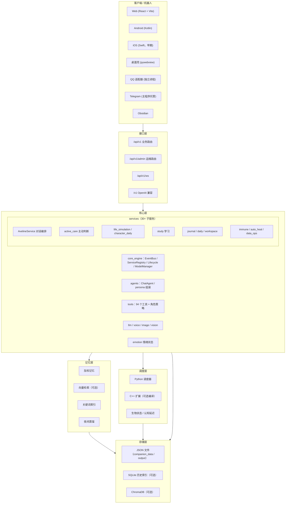

<div align="center">
  <picture>
    <source media="(prefers-color-scheme: dark)" srcset="autarkia-dark.svg">
    
  </picture>
  <p><strong>自托管 Agent 运行时：工具调用、长期记忆、主动任务与多角色隔离</strong></p>
  <p>
    <a href="https://github.com/hakituo/Autarkia/actions/workflows/core-ci.yml"></a>
    <a href="https://github.com/hakituo/Autarkia/actions/workflows/test-health.yml"></a>
    <a href="https://github.com/hakituo/Autarkia/actions/workflows/cpp-ci.yml"></a>
    <a href="https://github.com/hakituo/Autarkia/actions/workflows/web-ci.yml"></a>
    <a href="https://github.com/hakituo/Autarkia/actions/workflows/android-ci.yml"></a>
    <a href="LICENSE"></a>
    <a href="https://www.python.org/downloads/"></a>
  </p>
  <p><a href="readme.en.md">English</a> | 简体中文</p>
</div>

## 概述

Autarkia 是一个单机可运行的个人 Agent 后端：Python（FastAPI）单进程，C++ 调度扩展可选，本地 GGUF / Transformers 与云端 API 都可以作为推理后端。

对话是它的输入输出接口，不是能力边界。一次请求可以包含多轮工具调用、状态写入、记忆更新和后续任务；角色人设约束表达方式与内容边界，实际能力由工具层、记忆层和服务层提供。

### 设计取向

- **持续状态**：记忆、情绪、生理与作息状态跨会话保留，参与上下文组装和主动消息决策。
- **工具优先**：94 个工具、26 个领域，按角色配置常驻、按需和禁用；写操作带风险标注与权限校验。
- **主动但可控**：主动消息受静默时段、最小间隔、每日上限和角色白名单约束，可随时暂停或调频。
- **角色隔离**：记忆、历史、待办和工具集合按角色 scope 分开，数据在 `companion_data/<scope>_data/`。
- **可降级运行**：C++ 调度、ChromaDB、SQLite 索引均为可选，缺失时走 Python 或文件路径。

| 定位 | 说明 |
| --- | --- |
| 单机自托管 | 面向个人部署，不做多租户 |
| Agent 运行时 | 对话 + 工具循环 + 任务调度 + 状态存储 |
| 多角色 | 人设、记忆、工具权限按角色隔离 |
| 非纯对话产品 | 支持文件、日程、设备控制等外部操作 |

***

## 快速开始

### 环境要求

| 组件 | 要求 |
| --- | --- |
| Python | 3.10+（Linux 目标环境推荐 3.13） |
| Node.js | 18+（Web 前端） |
| CUDA | 11.8+（可选，本地 GPU 推理） |
| 内存 | 16GB+（推荐 32GB） |
| GPU 显存 | 8GB+（本地推理时；纯云端 API 模式不需要） |
| SoX / FFmpeg | 仅语音相关功能需要，需单独提供可执行文件 |

### 安装依赖

```powershell
# Windows CPU 环境；两条命令必须分开执行
.\venv_cpu\Scripts\python.exe -m pip install -r requirements\base.txt
.\venv_cpu\Scripts\python.exe -m pip install -r requirements\cpu.txt

# 校验依赖完整性
.\venv_cpu\Scripts\python.exe tests\scripts\environment\verify_runtime_dependencies.py --environment cpu
```

GPU 环境把 `venv_cpu` / `cpu.txt` 换成 `venv_core` / `gpu.txt`。完整说明见
[`requirements/README.md`](requirements/README.md)。

### 配置

```powershell
Copy-Item .env.example .env
```

配置优先级为「环境变量 > YAML > 代码默认值」。敏感信息（API Key、令牌）只放 `.env`；
系统开关在 `config/yaml/app.yaml`，模型参数和场景路由在 `config/yaml/sections/`。

### 启动

```powershell
# 仅后端
python main.py

# 或一次性拉起 TTS、生图、后端和前端开发服务器（脚本内使用 venv_core）
start_scripts\start_services.bat
```

Web 前端默认独立运行在 3000 端口，通过 Vite 代理访问 8000：

```powershell
cd clients\frontend\aveline-web
npm install
npm run dev
```

- Web：<http://localhost:3000>
- API 文档：<http://localhost:8000/docs>
- 单端口模式：把 `server.serve_frontend` 设为 `true`（PyInstaller 打包版会自动启用），
  此时 8000 直接托管 `clients/frontend/aveline-web/dist`。

***

## 一条消息怎么走

1. `routers/v1/chat.py`（HTTP）与 `/api/v1/ws`（WebSocket）接收请求，交给 `core/services/aveline/service.py` 的 `AvelineService`。
2. `core/agents/chat_agent.py` 的 `ChatAgent` 组装上下文：静态 system 人设 + 动态 user 前缀（时间、状态、记忆召回）+ 历史消息；拼装逻辑在 `chat_agent_components/persona_system/prompt/assembler.py`。
3. `core/llm/factory.py` 按配置选择后端：本地 GGUF（llama-cpp）、Transformers、云端路由或混合模式。
4. 模型决定调用工具时，`core/tools/execution.py` 先按角色策略校验权限，再执行并把结果交回模型，继续下一轮。
5. 流式输出经过 `chat_agent_components/streaming_pipeline/` 处理，结束后写入聊天历史、更新记忆，并触发后处理（纠正检测、学习沉淀、主动交互判断等）。

这仍然是一个请求-响应的对话系统，只是响应过程里可以包含多轮工具调用和状态写入，
而不是把用户的话原样转给模型再转回来。

***

## 能做什么

### 对话与工具

- 工具在 `core/tools/registry.py` 注册一次，角色通过 `config/tool_profiles.json` 获得各自的工具集合：
  `resident` 每轮发送、`on_demand` 按需发现、`disabled` 硬性禁用。
- 当前注册 **94 个工具、26 个领域**：文件、检索、日程、待办、提醒、学习、健康、媒体、同伴通信、
  设备观察与控制、远程操作等。
- 工具带风险标注：`external_write`（发消息、设提醒）、`device_control`（启停应用、壁纸、蓝牙）、
  `write`（写本地数据、沙箱执行代码）。权限检查与执行上下文在 `execution.py` 统一处理。
- 支持流式对话、工具结果回填、多轮工具循环，以及原生 schema / 本地文本协议两种调用方式。

### 记忆

- 加权记忆、关键词索引、向量检索、关系图、遗忘概率与夜间蒸馏，代码在 `memory/`。
- 向量检索默认使用本地 embedding 模型；模型或 ChromaDB 缺失时会退化到关键词与权重路径，
  不影响基础记忆读写。
- 记忆按角色隔离，落在 `companion_data/<scope>_data/`；用户侧资料在 `companion_data/user_data/`。
- 召回入口是 `memory/search_mixin.py` 的 `build_recall_bundle()`，对外暴露为
  `search_memory` / `search_chat_history` 工具。

### 主动性与生活状态

- `core/services/active_care/` 是一个常驻判断循环：定时检查 → 门控与节流 → 决策 → 发送后校验。
  触发来源包括到期提醒、长时间无互动、日程节点。
- 防打扰是硬约束：静默时段、最小间隔、每日上限、需要活跃客户端、按角色白名单开启；
  用户也可以直接暂停或调频（`pause_active_care` / `adjust_active_care_frequency`）。
- `core/services/life_simulation/` 维护饥饿、精力、睡眠等状态，`core/services/character_daily/` 生成角色自己的日程，
  这些状态会进入对话上下文和主动消息决策，而不是只做展示。

### 学习

- `core/services/study/` 包含学习画像、弱项追踪、教学编排与每日计划。
- 背单词使用 FSRS 调度（`core/tools/study/english/`），每日词表合并「昨天的错词」与「FSRS 已到期词」。
- 支持专注会话、错题与掌握度记录，前端有对应的学习面板。

### 多模态

- 语音：TTS provider 可配置；STT 支持 faster-whisper / paraformer 等本地后端。
- 视觉：多模态 LLM 优先，失败回退本地视觉模块；支持屏幕与手机截图理解。
- 图像生成：本地 ComfyUI / Forge，或云端 SiliconFlow，按配置切换。

### 运维与自我改进

- `core/services/immune/` 监控内存、CPU、错误爆发与服务健康，超阈值时降级或重启服务。
- `core/services/auto_heal/` 从运行日志里识别异常（错误爆发、重复异常、业务指标异常等），做根因分析、
  生成补丁，补丁先过沙箱与审批；只有低风险改动允许自动应用。
- `core/services/data_ops/` 负责日/周摘要、记忆压缩与信息抽取。
- `core/services/self_improvement/` 收集用户纠正，沉淀为学习记录并晋升为长期规则或 `MEMORY.md`，同时做漂移防护。

### 多端

- Web：React + Vite，开发端口 3000。
- Android：Kotlin + Jetpack Compose，含无障碍/Shizuku 设备控制与 Health Connect 穿戴数据。
- iOS：Swift，目前是早期实现，功能少于 Android。
- 桌面：`desktop_app.py` 用 pywebview 包一层窗口，支持透明置顶的宠物模式。
- 机器人：QQ 适配器独立进程（NapCat 传输层），Telegram 由主程序直接托管。
- 另外提供 OpenAI 兼容接口与 Obsidian 端点。

***

## 系统架构



| 层级 | 目录 | 职责 |
| --- | --- | --- |
| 客户端层 | `clients/` | Web、Android、iOS、桌面壳、QQ/Telegram 适配 |
| 接口层 | `routers/` | `/api/v1` 业务、`/api/v1/admin` 运维、WebSocket、OpenAI / Obsidian 兼容 |
| 核心层 | `core/` | 服务注册、对话编排、Agent、工具、模型适配、情绪 |
| 记忆层 | `memory/` | 加权记忆、向量检索、关键词索引、蒸馏 |
| 调度层 | `core/services/scheduler/`、`cpp_modules/cpp_scheduler/` | 任务队列、GPU/CPU 分工、模型生命周期 |
| 存储层 | `companion_data/`、`output/` | 按角色隔离的运行数据、媒体与沙箱产物 |

C++ 调度器是 **可选加速组件**：编译出 `scheduler_py` 扩展时启用，未编译时自动退回 Python 后端，
不影响主流程启动。

***

## 目录结构

```
autarkia/
├── clients/                    # 客户端与机器人
│   ├── bots/                   # QQ（独立进程）、Telegram、QQ 官方机器人
│   └── frontend/
│       ├── aveline-web/        # React + Vite Web
│       ├── aveline-android/    # Kotlin 原生客户端
│       └── aveline-ios/        # Swift 客户端（早期）
├── core/
│   ├── core_engine/            # EventBus / ServiceRegistry / LifecycleManager / ModelManager
│   ├── lifecycle/              # FastAPI lifespan 与启动编排
│   ├── agents/                 # ChatAgent 与 persona / prompt 组装
│   ├── services/               # 业务服务（30+ 子目录）
│   ├── tools/                  # 94 个工具、领域元数据与角色策略
│   ├── llm/                    # LLM 工厂与本地 / 云端适配
│   ├── emotion/                # 情绪状态与影响计算
│   ├── character/              # 角色人设、注册表与资料
│   ├── interfaces/             # WebSocket 适配与处理
│   ├── middleware/             # 安全、认证、限流
│   └── api/                    # 契约与错误响应
├── memory/                     # 加权记忆、向量检索、关键词索引、蒸馏
├── routers/                    # v1 业务、admin 运维、OpenAI 兼容、Obsidian
├── multimodal/                 # TTS / STT
├── cpp_modules/cpp_scheduler/  # C++ 调度扩展（可选编译）
├── config/                     # pydantic settings 与 yaml 配置
├── companion_data/             # 运行数据（按角色分目录）
├── output/                     # 媒体、缓存、沙箱产物
├── tests/                      # 测试与验证脚本
├── scripts/                    # 维护、部署、发布脚本
├── main.py                     # FastAPI 入口
└── desktop_app.py              # pywebview 桌面壳（含宠物模式）
```

***

## API

### 业务路由（`/api/v1`）

| 前缀 | 说明 |
| --- | --- |
| `/api/v1/chat` | 对话与流式输出 |
| `/api/v1/sessions` | 会话管理 |
| `/api/v1/memories` | 记忆查询与写入 |
| `/api/v1/context` | 设备、健康、日常、意图上下文 |
| `/api/v1/personas` | 角色人设 |
| `/api/v1/models` | 模型管理 |
| `/api/v1/plugins` | 插件 |
| `/api/v1/workspace` | 工作区文件 |
| `/api/v1/diary` | 日记 |
| `/api/v1/tasks` | 每日任务 |
| `/api/v1/study` | 专注会话 |
| `/api/v1/study-daily` | 学习计划、笔记与内容 |
| `/api/v1/tutor` | 教学画像 |
| `/api/v1/vocab` | 词汇与复习 |
| `/api/v1/health` | 健康检查 |
| `/api/v1/life` | 生命状态与作息 |
| `/api/v1/food` | 饮食与库存 |
| `/api/v1/user` | 用户状态 |
| `/api/v1/system` | 系统状态与工具 |
| `/api/v1/media` | 媒体与语音 |
| `/api/v1/vision` | 视觉与图像 |
| `/api/v1/peer-chat` | 角色间对话 |

### 运维路由（`/api/v1/admin`）

| 前缀 | 说明 |
| --- | --- |
| `/api/v1/admin/auto-heal` | 自愈分析与补丁 |
| `/api/v1/admin/data-ops` | 数据运维 |
| `/api/v1/admin/remote` | 远程操作（审批流） |
| `/api/v1/admin/memory` | 内存监控（旧地址 `/api/v1/memory` 仍保留） |

### 其他入口

- WebSocket：`/api/v1/ws`，用于流式对话、状态推送与主动消息。
- OpenAI 兼容：`/v1/chat/completions`。
- Obsidian：`/obsidian/v1`。
- 静态资源：`/static`、`/output`。

***

## 技术栈

| 层级 | 技术 |
| --- | --- |
| 后端 | FastAPI + Uvicorn（单进程） |
| 前端 | React 18 + TypeScript + Vite |
| 移动端 | Android（Kotlin + Compose）、iOS（Swift，早期） |
| 桌面 | pywebview + Edge WebView2 |
| 机器人 | QQ（NapCat 传输层）、Telegram（python-telegram-bot） |
| LLM | llama-cpp-python（GGUF）、Transformers、云端路由、混合模式 |
| 调度 | Python 调度器 + 可选 C++ 扩展（pybind11） |
| 存储 | JSON 文件为主；SQLite 历史索引与 ChromaDB 向量库均可选 |
| 语音 | faster-whisper / paraformer 等本地 STT；TTS provider 可配 |
| 图像 | 本地 ComfyUI / Forge，或云端 SiliconFlow |

***

## 配置

| 位置 | 用途 |
| --- | --- |
| `.env` | 敏感配置：API Key、令牌、本机路径 |
| `config/yaml/app.yaml` | 系统与服务总开关 |
| `config/yaml/sections/modeling.yaml` | 模型本体参数 |
| `config/yaml/sections/model_routing.yaml` | 各业务场景使用哪个模型 |
| `config/tool_profiles.json` | 角色工具策略（常驻 / 按需 / 禁用） |

```yaml
# config/yaml/app.yaml（节选）
scheduler:
  use_cpp: true
  llm_backend: "cpp"   # cpp | python

life_simulation:
  active_care_enabled: true
  active_care_enabled_roles: ["aveline", "ye"]
```

***

## 现状与边界

- **单机优先**：面向个人自托管，不做多租户隔离；数据都在本机 `companion_data/` 与 `output/`。
- **C++ 调度可选**：没有编译 `scheduler_py` 时自动使用 Python 后端，性能不同但功能可用。
- **外部依赖可降级**：ChromaDB、SQLite 索引缺失时退回文件与关键词路径；云端 API 与本地模型可混合。
- **iOS 端早期**：当前只有基础聊天、记忆、学习等页面，功能覆盖远少于 Android。
- **文档可能滞后**：架构细节以代码为准，按日期维护的改动记录在 `docs/updates/`。

***

## 文档

| 文档 | 路径 | 说明 |
| --- | --- | --- |
| 技术参考 | [`PROJECT_TECHNICAL_REFERENCE.md`](PROJECT_TECHNICAL_REFERENCE.md) | 架构、模块与数据流的详细说明 |
| 更新日志 | [`docs/updates/README.md`](docs/updates/README.md) | 按日归档的改动记录 |
| 工具清单 | [`core/tools/TOOL_CATALOG.md`](core/tools/TOOL_CATALOG.md) | 工具与领域清单（数量以 `registry.py` 为准） |
| 工具架构 | [`core/tools/README.md`](core/tools/README.md) | 角色策略、风险标注与调用链 |
| 客户端 | [`clients/README.md`](clients/README.md) | Web、移动端、机器人 |
| 服务层 | [`core/services/README.md`](core/services/README.md) | 各子服务职责与联动 |
| 记忆系统 | [`memory/README.md`](memory/README.md) | 记忆模型与检索 |
| 路由层 | [`routers/README.md`](routers/README.md) | 路由组织方式 |
| 测试 | [`tests/README.md`](tests/README.md) | 测试分层与运行方式 |

***

## 贡献

- Python 遵循 PEP 8，行宽 100；前端使用 ESLint + Prettier。
- 新增工具需要补 `tool_metadata.py` 的领域与风险标注。
- 提交前跑测试：`venv_cpu\Scripts\python.exe -m pytest -q`（`addopts` 已带 `-n 4`）。
- 改动说明写入当天 `docs/updates/YYYY/MM/YYYY-MM-DD.md`，commit 只写一句话摘要。

## 角色与工具配置

常驻、按需和禁用工具按角色 scope 集中配置在 `config/tool_profiles.json`。没有单独配置的角色继承默认值
（工具检索、待办、聊天记录查询、网页搜索与网页抓取五项常驻），叶的配置在此基础上额外常驻现场状态更新、
好友印象记录与学习数据管理；其余工具按领域按需加载，也可单独禁用。角色数据、历史和记忆按
`companion_data/<scope>_data/` 隔离，互不串用。

## License

AGPLv3

Copyright (C) 2026 hakituo. 本项目基于 GNU AGPLv3 许可证发布：允许商业使用与修改，但修改后的网络服务部署同样需要开放相应源码；详情见 [LICENSE](LICENSE)。
